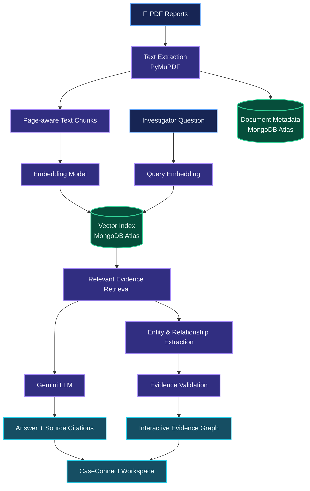
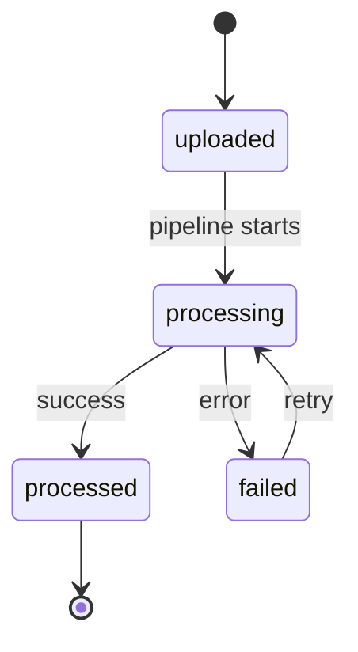
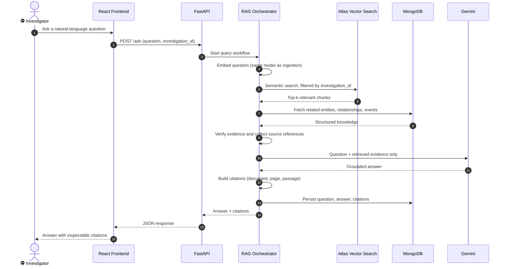
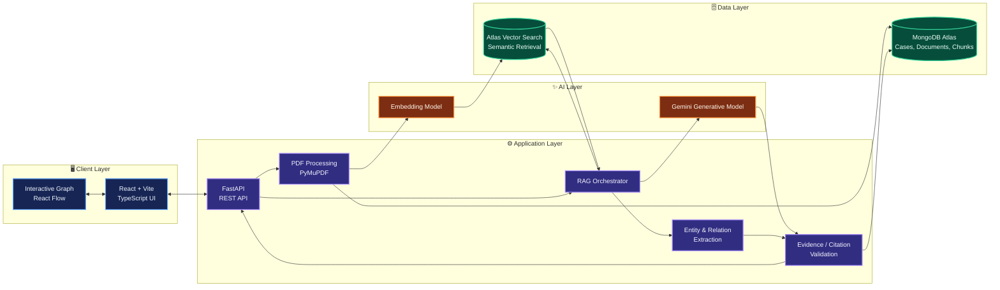
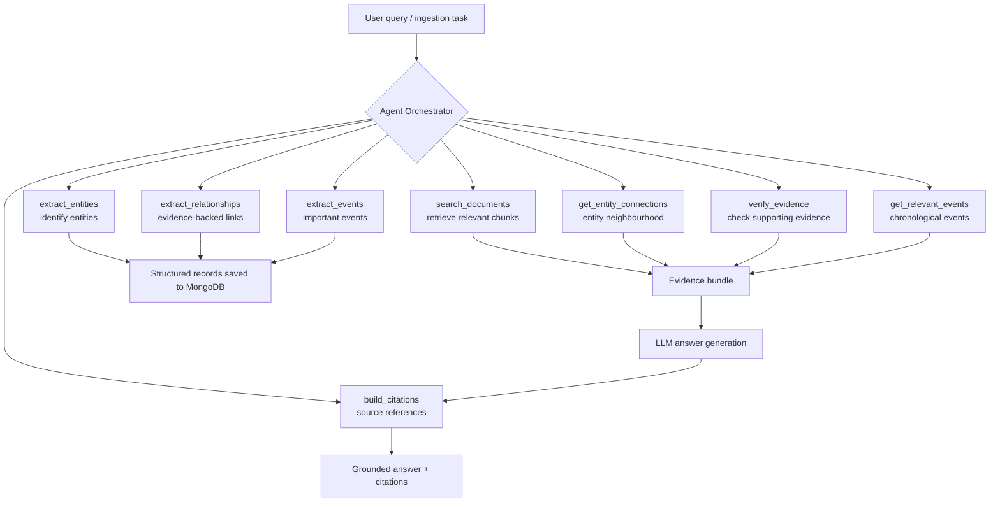
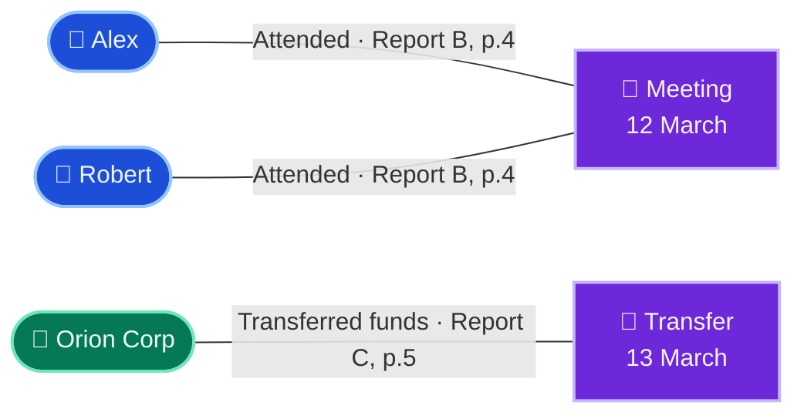
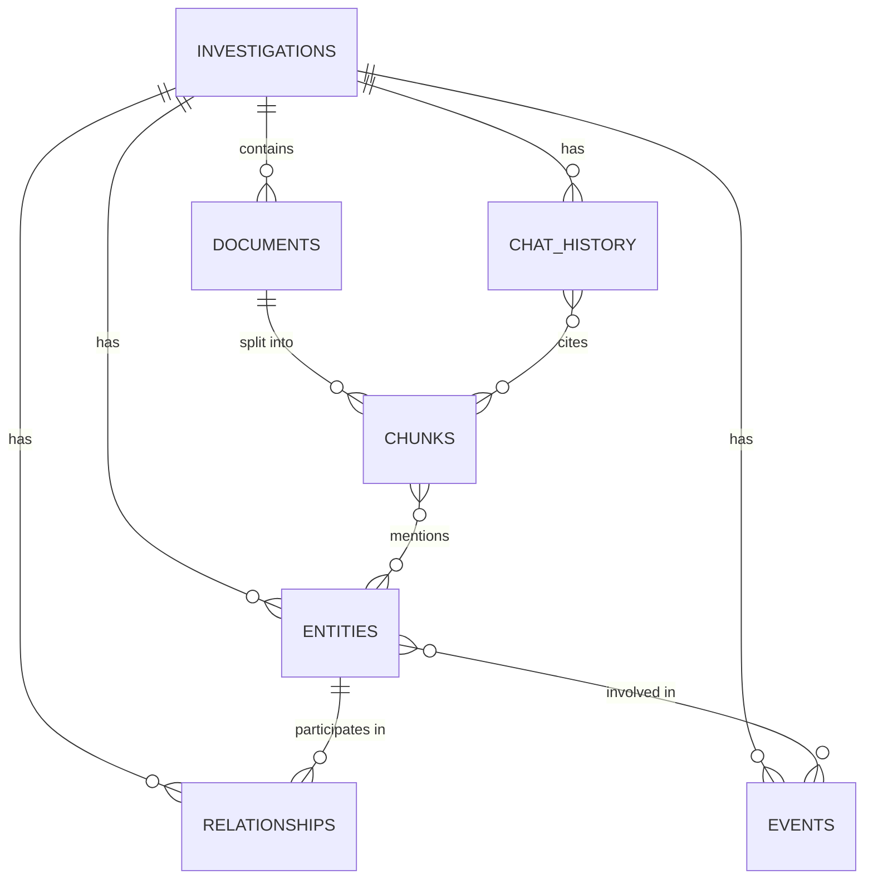
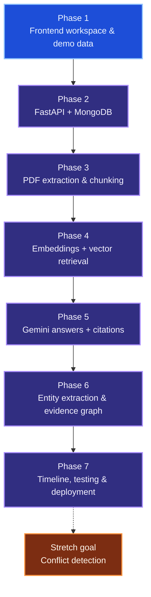

<div align="center">

# 🕵️ CaseConnect

### AI-Powered Investigation Intelligence & Evidence Discovery Platform

**Turn scattered reports into evidence-backed answers and explainable connections.**


_Investigate smarter. Connect the evidence. Keep every claim traceable._

</div>

---

## 📌 Contents

- [Overview](#-overview)
- [The Problem](#-the-problem)
- [Our Solution](#-our-solution)
- [Key Features](#-key-features)
- [How It Works](#-how-it-works)
- [Pipelines Explained](#-pipelines-explained)
- [System Architecture](#-system-architecture)
- [AI Agent Orchestrator](#-ai-agent-orchestrator)
- [Evidence Graph](#-evidence-graph)
- [Database Design](#-database-design)
- [Technology Stack](#-technology-stack)
- [Project Structure](#-project-structure)
- [Getting Started](#-getting-started)
- [Configuration and Security](#-configuration-and-security)
- [MongoDB Atlas Vector Search Setup](#-mongodb-atlas-vector-search-setup)
- [API Design](#-api-design)
- [Demo Scenario](#-demo-scenario-orion-financial-network)
- [Responsible AI and Evidence Integrity](#-responsible-ai-and-evidence-integrity)
- [Roadmap](#-roadmap)
- [Team](#-team)
- [Contributing](#-contributing)
- [License and Disclaimer](#-license-and-disclaimer)

---

## 🔎 Overview

**CaseConnect** is an AI-assisted investigation workspace that helps analysts explore information spread across multiple PDF reports. It brings document search, retrieval-augmented generation (RAG), source citations, entity extraction, relationship discovery, a chronological timeline, and an interactive evidence graph into one workflow.

Instead of manually reading every report and trying to remember how names, organisations, events, dates, and locations relate, an investigator can ask a question and inspect the supporting passages.

> **Core principle:** AI should help investigators discover and understand evidence, not replace evidence with unsupported assumptions. A connection is shown as _confirmed_ only when there is supporting evidence. Similar names, co-occurrence, or events close together in time are not proof of a relationship.

> **Project status:** the current frontend prototype may use mock/sample data. The architecture below describes the intended end-to-end system. Only mark a component as implemented once it is connected and tested in the repository.

## 🎯 The Problem

Investigation information is fragmented across reports and documents, which makes it difficult to:

- Find relevant details across many files.
- Track the source and page for each claim.
- Discover relationships between people, organisations, events, and places.
- Reconstruct an accurate chronological sequence from separate reports.
- Spot conflicting statements between sources.
- Distinguish documented facts from assumptions or possible leads.

## 💡 Our Solution

CaseConnect combines document processing, semantic retrieval, and evidence-aware AI into an investigator-friendly workspace.

1. Upload PDF reports to an investigation.
2. Extract text while preserving document and page references.
3. Split text into searchable chunks and create embeddings.
4. Retrieve relevant passages for an investigator's question.
5. Ask Gemini to synthesise an answer from the retrieved evidence only.
6. Display citations that point back to the source documents and pages.
7. Extract candidate entities, relationships and events, validate them against evidence, and visualise the supported connections in an interactive graph and timeline.

## ✨ Key Features

| Feature                       | What it does                                                                                                | Priority     |
| ----------------------------- | ----------------------------------------------------------------------------------------------------------- | ------------ |
| 🗂️ Investigation workspace    | Separate workspaces per case, each with its own documents, entities, relationships, events and chat history | Core         |
| 📄 PDF intelligence           | Extracts text and preserves page-level source references                                                    | Core         |
| 🧠 AI investigation assistant | Answers questions using retrieved evidence rather than general model knowledge                              | Core         |
| 🔗 Evidence citations         | Shows the document, page and passage supporting an answer or relationship                                   | Core         |
| 🕸️ Interactive evidence graph | Visualises entities and evidence-backed relationships                                                       | Core         |
| 🗓️ Investigation timeline     | Arranges dated events chronologically with sources                                                          | Next         |
| ⚠️ Conflict detection         | Flags potentially inconsistent claims for human review                                                      | Stretch goal |

---

## 🔄 How It Works



### A typical question

> "What documented connections exist between Alex, Robert, and Orion Corp?"

CaseConnect retrieves the relevant passages from each report, extracts the claims those passages support, and returns a concise answer with citations. If the reports do not establish a direct relationship between two entities, the system says so instead of inventing one.

---

## 🧪 Pipelines Explained

CaseConnect has two primary AI workflows: **Ingestion** (PDFs to structured evidence) and **RAG Q&A** (questions to cited answers).

### A. Document Ingestion Pipeline

```mermaid
flowchart LR
    A["📤 1. Upload PDFs"] --> B["📑 2. Extract text<br/>page by page"]
    B --> C["✂️ 3. Chunk text<br/>overlapping chunks"]
    C --> D["🔢 4. Generate embeddings"]
    D --> E["💾 5. Store chunks + vectors<br/>MongoDB Atlas"]
    E --> F["🧠 6. Extract entities<br/>LLM"]
    F --> G["🔗 7. Discover relationships<br/>with source passages"]
    G --> H["📅 8. Extract events<br/>and dates"]
    H --> I["✅ 9. Save evidence<br/>mark document processed"]
```



| Step                          | What happens                                                                                                                       |
| ----------------------------- | ---------------------------------------------------------------------------------------------------------------------------------- |
| **1. Upload**                 | The investigator creates an investigation and uploads PDF reports. Files are validated by content and size, not by filename alone. |
| **2. Text extraction**        | PyMuPDF extracts text page by page, preserving original page numbers.                                                              |
| **3. Chunking**               | Text is split into overlapping chunks. Each chunk keeps its `investigation_id`, `document_id`, `chunk_index` and `page_number`.    |
| **4. Embeddings**             | Each chunk is converted into a vector that captures its semantic meaning.                                                          |
| **5. Vector storage**         | Chunks and embeddings are stored in MongoDB Atlas and indexed by Atlas Vector Search.                                              |
| **6. Entity extraction**      | The LLM identifies people, organisations, locations and events.                                                                    |
| **7. Relationship discovery** | Evidence-backed relationships are identified and tied to their source passages.                                                    |
| **8. Event extraction**       | Important events and dates are extracted for the timeline.                                                                         |
| **9. Evidence storage**       | Entities, relationships, events and citations are saved, and the document status becomes `processed`.                              |

**Document processing statuses**



### B. RAG Question-Answering Pipeline



If the retrieved evidence is insufficient, the assistant states that limitation instead of inventing an answer.

---

## 🏗️ System Architecture

The following is the **target architecture**. It is a design map, not a claim that every service is already implemented.



### Component responsibilities

| Component           | Responsibility                                                                                     |
| ------------------- | -------------------------------------------------------------------------------------------------- |
| React frontend      | Investigation dashboard, document views, chat, citations, graph and timeline                       |
| FastAPI backend     | Validates requests, coordinates processing, exposes REST endpoints                                 |
| PyMuPDF             | Extracts text from PDFs while retaining page numbers                                               |
| Embedding model     | Converts chunks and questions into vectors for semantic similarity                                 |
| MongoDB Atlas       | Stores investigation metadata, documents, chunks, entities, relationships, events and chat history |
| Atlas Vector Search | Retrieves semantically relevant chunks from the indexed evidence                                   |
| Gemini              | Synthesises answers and proposes entities/relationships from retrieved passages                    |
| Evidence validator  | Checks that claims and graph edges have traceable source evidence                                  |
| React Flow          | Renders the entity relationship graph in the browser                                               |

> **Important distinction:** Gemini does not perform the search. The embedding model represents text as vectors, vector search retrieves relevant passages, and Gemini then reasons over those passages to draft an answer. The backend must preserve citations and validate relationships before displaying them as evidence-backed.

---

## 🤖 AI Agent Orchestrator

CaseConnect uses a **single custom Python orchestrator** rather than multiple autonomous agents. It decides which tools to call, collects evidence, and manages answer generation, which keeps the system predictable and easy to extend.



| Tool                       | Responsibility                                 |
| -------------------------- | ---------------------------------------------- |
| `search_documents()`       | Retrieve relevant document chunks              |
| `extract_entities()`       | Identify entities from text                    |
| `extract_relationships()`  | Identify evidence-backed relationships         |
| `extract_events()`         | Extract important events                       |
| `get_entity_connections()` | Retrieve connections associated with an entity |
| `verify_evidence()`        | Check the evidence supporting a relationship   |
| `get_relevant_events()`    | Retrieve relevant chronological events         |
| `build_citations()`        | Construct source references                    |

---

## 🕸️ Evidence Graph

Nodes represent entities or events. Edges represent relationships supported by one or more source passages.



_Illustrative sample only._ The diagram deliberately does **not** draw a direct Alex to Orion Corp edge: events on nearby dates are not enough to prove a relationship.

### Relationship statuses

| Status            | Meaning                                                                                        |
| ----------------- | ---------------------------------------------------------------------------------------------- |
| 🟢 **Confirmed**  | Explicitly supported by source evidence                                                        |
| 🟡 **Possible**   | Plausible connection inferred from multiple pieces of evidence, but not explicitly established |
| 🔴 **Unverified** | Insufficient evidence to establish the relationship                                            |

An LLM confidence score is **never** treated as proof of a relationship.

### What each edge stores

- Source entity and target entity
- Relationship label and status
- Supporting document ID and page number
- The exact supporting passage or a short excerpt
- Extraction timestamp and review status, where applicable

### Visual convention

- 🔵 **Blue nodes**: people
- 🟢 **Green nodes**: organisations
- 🟣 **Purple nodes**: events
- 🟠 **Orange markers**: claims requiring review or uncertain links

Colours are a visual aid, not a substitute for evidence or status labels.

---

## 🗄️ Database Design

CaseConnect uses seven MongoDB collections. Every investigation-specific record carries an `investigation_id` to keep data isolated between cases.



| Collection       | Responsibility                                        |
| ---------------- | ----------------------------------------------------- |
| `investigations` | Investigation details and metadata                    |
| `documents`      | Uploaded PDF metadata and processing status           |
| `chunks`         | Extracted text chunks and embedding vectors           |
| `entities`       | People, organisations, locations and events           |
| `relationships`  | Connections between entities with supporting evidence |
| `events`         | Chronological events and their source references      |
| `chat_history`   | Investigator questions, AI responses and citations    |

**Citation object**

```json
{
  "document_id": "665f1c2e9b1e8a0012a4c111",
  "document_name": "Meeting_Minutes_March.pdf",
  "page_number": 4,
  "chunk_id": "665f1c2e9b1e8a0012a4c222",
  "passage": "…supporting text from the original document…"
}
```

---

## 🧰 Technology Stack

| Layer               | Technology                                         | Purpose                                            |
| ------------------- | -------------------------------------------------- | -------------------------------------------------- |
| Frontend            | React, Vite, TypeScript, Tailwind CSS              | Responsive investigation interface                 |
| Graph visualisation | `@xyflow/react` (React Flow)                       | Interactive node-edge evidence graph               |
| API client          | Axios                                              | Frontend to backend communication                  |
| Backend             | Python, FastAPI, Pydantic                          | REST API, validation and workflow orchestration    |
| PDF processing      | PyMuPDF                                            | Text extraction with page references               |
| Generative AI       | Gemini API (`google-genai`)                        | Evidence-grounded answers and candidate extraction |
| Embeddings          | Gemini embedding model or another compatible model | Semantic representations of text and questions     |
| Database            | MongoDB Atlas (PyMongo)                            | Persistent investigation and document data         |
| Semantic retrieval  | MongoDB Atlas Vector Search                        | Similarity search over document chunks             |
| API testing         | FastAPI Swagger UI / Postman                       | Endpoint testing                                   |

> Confirm exact package versions and enabled services in the repository before presenting them as the final deployed stack.

---

## 🗂️ Project Structure

This is a recommended layout. Adapt it to the files your team has already created rather than replacing the existing app structure.

```text
caseconnect/
├── frontend/
│   ├── public/
│   ├── src/
│   │   ├── components/
│   │   ├── pages/
│   │   ├── features/
│   │   │   ├── investigations/
│   │   │   ├── documents/
│   │   │   ├── assistant/
│   │   │   ├── evidence-graph/
│   │   │   └── timeline/
│   │   ├── services/            # API client
│   │   ├── types/
│   │   └── App.tsx
│   ├── .env.example
│   └── package.json
├── backend/
│   ├── app/
│   │   ├── main.py
│   │   ├── config.py
│   │   ├── routes/
│   │   ├── services/
│   │   │   ├── pdf_service.py
│   │   │   ├── chunking_service.py
│   │   │   ├── embedding_service.py
│   │   │   ├── retrieval_service.py
│   │   │   ├── gemini_service.py
│   │   │   └── graph_service.py
│   │   ├── agents/
│   │   │   ├── orchestrator.py
│   │   │   └── tools/           # search_documents, verify_evidence, build_citations, ...
│   │   ├── models/              # Pydantic schemas
│   │   └── db/
│   ├── requirements.txt
│   └── .env.example
├── sample_data/                 # Fictional demo PDFs
├── docs/
│   └── architecture.md
├── .gitignore
└── README.md
```

---

## 🚀 Getting Started

### Prerequisites

| Requirement    | Notes                                            |
| -------------- | ------------------------------------------------ |
| Git            | Any recent version                               |
| Node.js        | 18 or higher, with npm                           |
| Python         | 3.10 or higher                                   |
| MongoDB Atlas  | A free (M0) cluster with Vector Search available |
| Gemini API key | Create one in Google AI Studio                   |

### 1. Clone the repository

Replace `<your-repository-url>` with your actual GitHub repository URL.

```bash
git clone <your-repository-url>
cd caseconnect
```

### 2. Run the frontend

Use the package manager and scripts present in `frontend/package.json`.

```bash
cd frontend
npm install
cp .env.example .env     # Windows: copy .env.example .env
npm run dev
```

Vite prints the local URL in the terminal (commonly `http://localhost:5173`).

### 3. Set up the backend (when backend code is present)

```bash
cd backend
python -m venv .venv
```

Activate the environment:

**Windows PowerShell**

```powershell
.\.venv\Scripts\Activate.ps1
```

**macOS / Linux**

```bash
source .venv/bin/activate
```

Install dependencies, create your environment file, and start FastAPI (adjust the module path if your project differs):

```bash
pip install -r requirements.txt
cp .env.example .env     # Windows: copy .env.example .env
uvicorn app.main:app --reload
```

Open `http://127.0.0.1:8000/docs` to explore the API documentation.

### 4. Verify the workflow

- [ ] Create an investigation.
- [ ] Upload sample PDF reports.
- [ ] Confirm extracted text retains document and page references.
- [ ] Ask a question whose answer appears in the reports.
- [ ] Verify that the answer cites the correct passages.
- [ ] Inspect the evidence graph and open the evidence for an edge.
- [ ] Ask a question the reports cannot answer. The system should clearly say evidence is insufficient.

---

## 🔐 Configuration and Security

### `backend/.env.example`

```env
# ───────── Application ─────────
APP_ENV=development
APP_HOST=0.0.0.0
APP_PORT=8000
CORS_ORIGINS=http://localhost:5173

# ───────── Gemini ─────────
GEMINI_API_KEY=replace_with_your_gemini_api_key
GEMINI_MODEL=replace_with_a_current_gemini_model_name
GEMINI_EMBEDDING_MODEL=replace_with_a_current_gemini_embedding_model
EMBEDDING_DIMENSIONS=replace_with_embedding_vector_size

# ───────── MongoDB Atlas ─────────
MONGODB_URI=mongodb+srv://<username>:<password>@<cluster-host>/?retryWrites=true&w=majority
DATABASE_NAME=caseconnect
VECTOR_INDEX_NAME=chunk_vector_index

# ───────── Document Processing ─────────
CHUNK_SIZE=1000
CHUNK_OVERLAP=200
MAX_UPLOAD_SIZE_MB=25

# ───────── Retrieval ─────────
TOP_K_CHUNKS=8
```

### `frontend/.env.example`

```env
VITE_API_BASE_URL=http://localhost:8000
```

> Check Google's documentation for current Gemini model names and the embedding vector size, then fill in the placeholders above.

### Security notes

- Keep Gemini and MongoDB credentials on the **backend only**.
- Never expose secrets through frontend variables such as `VITE_GEMINI_API_KEY`.
- Do not commit real `.env` files. Add `.env`, `.venv/`, `node_modules/`, uploaded private documents and generated local data to `.gitignore`.
- Use a MongoDB database user with only the permissions the application needs.
- Validate file type and size, and do not trust a filename alone to identify a PDF.
- Avoid logging full report contents, credentials or sensitive personal information.
- Use fictional or authorised documents for demos and testing.

---

## 🧭 MongoDB Atlas Vector Search Setup

In Atlas, open your cluster, go to **Search & Vector Search**, click **Create Search Index**, choose **Atlas Vector Search** with the **JSON Editor**, select the `chunks` collection in your database, name the index `chunk_vector_index`, and use:

```json
{
  "fields": [
    {
      "type": "vector",
      "path": "embedding",
      "numDimensions": 768,
      "similarity": "cosine"
    },
    {
      "type": "filter",
      "path": "investigation_id"
    }
  ]
}
```

- `numDimensions` **must match** the output size of your embedding model. Replace `768` with the real value for the model you configure.
- The `investigation_id` filter field keeps retrieval isolated to the selected investigation.
- Wait until the index status shows **Active** before running queries.

---

## 🔌 API Design

These are suggested endpoints for the intended backend and may not exist yet. Swagger at `/docs` is the source of truth once the backend runs.

| Method | Endpoint                             | Purpose                                   |
| ------ | ------------------------------------ | ----------------------------------------- |
| `GET`  | `/health`                            | Check API status                          |
| `GET`  | `/api/investigations`                | List investigations                       |
| `POST` | `/api/investigations`                | Create an investigation                   |
| `GET`  | `/api/investigations/{id}`           | Get investigation details                 |
| `POST` | `/api/investigations/{id}/documents` | Upload a PDF report                       |
| `GET`  | `/api/investigations/{id}/documents` | List case documents and processing status |
| `POST` | `/api/investigations/{id}/ask`       | Ask an evidence-grounded question         |
| `GET`  | `/api/investigations/{id}/graph`     | Get graph nodes and evidence-backed edges |
| `GET`  | `/api/investigations/{id}/timeline`  | Get dated events                          |

Answers should return structured citations rather than plain text alone, so the UI can let users inspect the source.

```bash
curl -X POST http://localhost:8000/api/investigations/<INVESTIGATION_ID>/ask \
  -H "Content-Type: application/json" \
  -d '{"question": "What connections exist between Alex, Robert, and Orion Corp?"}'
```

---

## 🎬 Demo Scenario: Orion Financial Network

The project can be demonstrated with a fully **fictional** investigation, **Orion Financial Network**, made of several PDF reports with overlapping people, organisations, transactions, communications, locations and events.

| Category          | Examples                                                               |
| ----------------- | ---------------------------------------------------------------------- |
| **People**        | Alex Mercer, Robert Vance, Elena Park                                  |
| **Organisations** | Orion Corp, Northstar Consulting Ltd                                   |
| **Locations**     | London, Geneva, Rotterdam                                              |
| **References**    | EUR 280,000 transaction, Invoice 77B, Payment TX-7741, Shipment RDM-19 |
| **Built-in test** | A deliberate discrepancy between two separate meeting accounts         |

**Try these questions after processing the reports:**

- _What connections exist between Alex, Robert, and Orion Corp?_
- _Which reports mention the EUR 280,000 transaction?_
- _What events involved Elena Park?_
- _Are there inconsistencies between the different meeting accounts?_

---

## 🧭 Responsible AI and Evidence Integrity

CaseConnect is an **investigation support tool**, not an autonomous decision-maker.

- **Cite claims:** factual answers should be traceable to report passages.
- **Separate fact from inference:** label possible leads and uncertain relationships clearly.
- **Do not fabricate edges:** entity co-occurrence or date proximity alone must not establish a direct relationship.
- **Distrust confidence scores:** an LLM confidence score is not proof.
- **Support review:** let users open the evidence behind an answer or graph connection.
- **Flag discrepancies, don't judge them:** a detected inconsistency is a potential discrepancy for human review, not proof that one statement is false.
- **Acknowledge missing evidence:** when the retrieved documents do not support an answer, say so.
- **Preserve provenance:** keep document and page metadata through extraction, chunking, retrieval and graph construction.
- **Isolate cases:** retrieval must stay restricted to the selected investigation.
- **Protect data:** use authorised source material and restrict access to investigation documents.

---

## 🗺️ Roadmap



- [ ] Frontend prototype and navigation
- [ ] Investigation and document persistence
- [ ] PDF extraction with page metadata
- [ ] Semantic retrieval and evidence-grounded responses
- [ ] Source citations in the assistant
- [ ] Entity and relationship extraction
- [ ] Interactive evidence graph
- [ ] End-to-end testing with fictional reports
- [ ] Timeline and conflict detection (stretch goals)

**Future ideas:** OCR for scanned PDFs, entity resolution and alias matching, DOCX/TXT support, authentication and role-based access, collaboration and sharing, report export, advanced graph analytics, and document version management.

_Update the checklist as features are actually completed._

---

## 👥 Team

Built with curiosity and collaboration by:

| Team member           | Focus               |
| --------------------- | ------------------- |
| **Shiva Malekar**     | Project development |
| **Samridh Sethi**     | Project development |
| **Shaurya Prajapati** | Project development |

_Update each person's focus area to reflect your actual division of work._

---

## 🤝 Contributing

We work as a team and recommend feature branches:

1. Pull the latest changes from `main`.
2. Create a branch for your task, for example `feat/evidence-graph`.
3. Make a focused change and test it locally.
4. Commit with a clear message.
5. Push the branch and open a pull request.
6. Review and test before merging into `main`.

```bash
git switch main
git pull origin main
git switch -c feat/your-feature
# Make and test your changes
git add .
git commit -m "feat: describe the change"
git push -u origin feat/your-feature
```

---

## 📜 License and Disclaimer

Add a `LICENSE` file and name your chosen license here.

**Disclaimer:** CaseConnect is a decision-support tool that assists human investigators with evidence discovery. AI-generated output can contain errors and must be independently verified against the original documents. It does not determine guilt, establish legal conclusions, or replace professional investigation. All demonstration data is fictional.

---

<div align="center">

### 🧩 From documents to evidence. From evidence to insight.

**CaseConnect: investigate with context, clarity, and traceability.**

</div>
